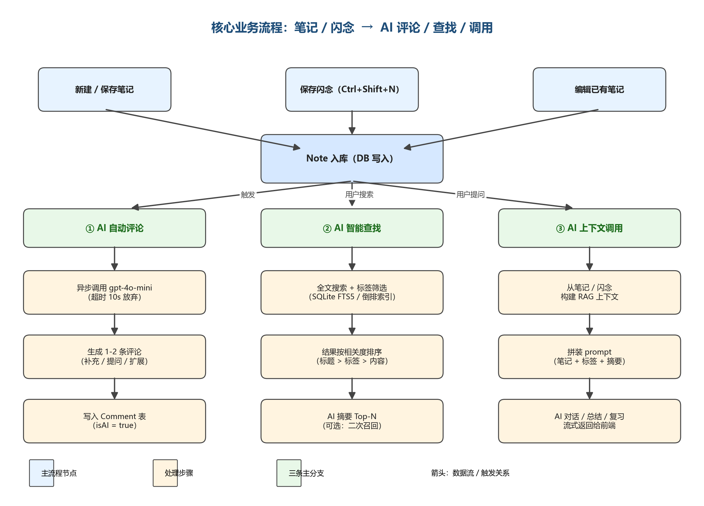

# 需求规格说明书

| 项目名称 | **AI智能笔记**（原名 Blinko） |
|---|---|
| 文档版本 | v1.0 |
| 编写日期 | 2026-08-31 |
| 编写人 | 产品经理 / 需求分析师 |
| 审核人 | 待定 |

> 本文档基于《项目立项书》对 AI智能笔记 的功能和非功能需求进行详细描述，作为系统设计、开发和测试的依据。
> 项目代码仓库：<https://github.com/Su-Qingmu/blinko-homework>

---

## 1. 项目概述

### 1.1 项目背景

大学生和自学者日常会产生大量零散信息：课堂笔记、复习要点、AI 对话中的优秀解释与代码片段、闪现的灵感。现有学习方式存在以下问题：

- **信息分散**：ChatGPT / Claude / Notion / 微信收藏夹各自为政，优质内容散落各处。
- **复制成本高**：想把 AI 对话中的好回答整理成笔记，需要切换软件、调整格式，"仪式感"重，懒得记。
- **上下文割裂**：笔记软件不知道 AI 在聊什么，AI 也不知道笔记里写过什么，无法形成体系。
- **复习无抓手**：笔记存了一堆，复习时没有引导，记了等于没记。

**AI智能笔记** 定位为以"笔记 / 闪念" 为核心、AI 能力为亮点的学习笔记平台：用户用**闪念**快速捕抓灵感，用**笔记**系统化整理，AI 在背后做**评论 / 查找 / 调用**三种能力，让每一条记录都能被复习、被检索、被对话。

> **主要功能**：笔记 / 闪念的创建与管理。  
> **亮点功能**：AI 评论 / AI 查找 / AI 调用。

### 1.2 目标用户

| 用户角色 | 典型场景 | 核心诉求 |
|---|---|---|
| **大学生 / 研究生** | 课堂记录、复习巩固、考试整理 | 快速记笔记、AI 评论辅助理解、闪念速记 |
| **自学者 / 考研党** | 知识体系搭建、长期复习 | AI 对话沉淀、标签搜索、AI 总结 |
| **职场新人** | 工作笔记、会议记录 | 跨笔记关联、AI 摘要 |

### 1.3 产品定位

面向大学生与自学者群体的 AI 驱动学习笔记平台：以笔记 / 闪念为基础，AI 评论 / 查找 / 调用为三大能力，构建"记 → 评 → 找 → 用"的学习闭环。

**差异化对比**

| 对比项 | 传统笔记（Notion / 印象笔记） | 纯 AI 工具（ChatGPT / Claude） | **AI智能笔记（本项目）** |
|---|---|---|---|
| 笔记 / 闪念 | ✅ 手动为主 | ❌ 无 | ✅ 一等公民，全快捷键 + Markdown |
| AI 评论 | ❌ 弱或无 | ❌ 无 | ✅ 保存即自动评论 |
| AI 查找 | ⚠️ 关键词搜索 | ❌ 对话历史难找 | ✅ 全文搜索 + 标签 + AI 摘要 |
| AI 调用 | ❌ 无 | ✅ 但上下文割裂 | ✅ 以笔记为 RAG 上下文 |
| 知识沉淀 | 手动归档 | 无沉淀 | 自动入知识库 + 可复习 |

### 1.4 项目目标（可量化）

- **功能目标**：跑通"笔记 / 闪念 → AI 评论 / 查找 / 调用"完整学习闭环。
- **数据目标**：支持 100 名用户同时在线，核心接口 100 QPS。
- **质量目标**：核心接口响应 < 500ms；单测覆盖率 ≥ 50%。
- **运营目标**：课程周期内完成 ≥ 50 篇笔记、≥ 30 条 AI 评论、≥ 20 次 AI 对话交互。

---

## 2. 功能需求

### 2.1 功能清单与优先级

| 编号 | 功能模块 | 功能描述 | 优先级 | 验收状态 |
|---|---|---|---|---|
| 1 | 用户系统 | 注册 / 登录 / 登出 + Session 鉴权 + 数据隔离 | P0 | 未验收 |
| 2 | 笔记管理 | 笔记 CRUD + Markdown + 标签 + 全文搜索 | P0 | 未验收 |
| 3 | 闪念速记 | 全局快捷键 Ctrl/Cmd+Shift+N + 一句话记录 + 升级为笔记 | P0 | 未验收 |
| 4 | AI 评论 | 保存笔记后 AI 自动生成 1-2 条评论（补充 / 提问 / 扩展） | P0 | 未验收 |
| 5 | AI 查找 | 全文搜索 + 标签筛选 + AI 摘要 Top-N | P0 | 未验收 |
| 6 | AI 调用 | 以笔记 / 闪念为上下文调用 AI（对话 / 总结 / 复习） | P1 | 未验收 |
| 7 | AI 对话 | 多轮对话 + 流式输出 + 历史持久化（作为 AI 调用的入口之一） | P1 | 未验收 |
| 8 | 用户管理 | 个人资料、密码修改、笔记 / 闪念 / 评论统计 | P1 | 未验收 |
| 9 | 标签管理 | 用户私有标签，多对多关联笔记 | P1 | 未验收 |
| 10 | 双向追溯 | 笔记 ↔ 对话（Message.savedAsNoteId） | P2 | 未验收 |
| 11 | 暗色模式 | 浅 / 深主题切换 | P2 | 未验收 |
| 12 | AI API 成本控制 | gpt-4o-mini + 上下文截断 + 请求缓存 | P2 | 未验收 |

> **优先级定义**：P0 = 必须有，缺了核心闭环不完整；P1 = 重要，时间允许必须做；P2 = 加分项，可不做。

### 2.2 核心业务流程

> **主要功能**：笔记 / 闪念的创建与管理。  
> **亮点**：AI 在笔记入库后做三种能力——**评论**（自动点评）、**查找**（全文 + AI 摘要）、**调用**（以笔记为上下文对话 / 总结 / 复习）。



**流程说明**

1. **入口（三个）**：新建 / 保存笔记、保存闪念（Ctrl+Shift+N）、编辑已有笔记 → 统一写入 Note 表。
2. **入库后三分支**：
   - **① AI 自动评论**：异步调用 gpt-4o-mini 生成 1-2 条评论，写入 Comment 表（isAI=true），不阻塞保存。
   - **② AI 智能查找**：用户搜索时走全文搜索 + 标签筛选，可选 AI 摘要 Top-N 二次召回。
   - **③ AI 上下文调用**：从笔记 / 闪念构建 RAG 上下文，AI 对话 / 总结 / 复习时以笔记为 prompt 上下文。

### 2.3 功能详细描述

#### 2.3.1 用户注册 / 登录

**前置条件**：用户持有有效邮箱。

**交互流程**：
1. 注册：输入邮箱 → 设置昵称与密码（≥ 8 位且含字母和数字）→ 进入首页。
2. 登录：输入邮箱 + 密码 → Session 鉴权 → 进入首页。
3. 登出：清除本地 Session，跳转回登录页。

**输入与校验规则**：
- 邮箱格式校验；昵称 2~16 字符。
- 密码 ≥ 8 位且包含字母和数字。
- 连续 5 次密码错误锁定账号 15 分钟。

**异常处理**：
- 邮箱已注册 → 引导去登录。
- 账号被锁定 → 提示"请 15 分钟后再试"。

**验收标准**：
- 非法邮箱提交时，提交按钮置灰并提示具体错误。
- 密码错误连续 5 次后，第 6 次登录提示"账号已锁定，请 15 分钟后重试"。

---

#### 2.3.2 笔记管理

**能力**：创建 / 编辑 / 删除 / 归档 / Markdown 渲染 / 标签管理 / 全文搜索。

**交互流程**：
1. **创建**：笔记列表页点击"新建"→ 进入编辑器 → 输入标题（可选）与内容（Markdown）→ 选择标签 → 保存。
2. **编辑**：笔记详情页点击"编辑"→ 修改后保存（异步重新触发 AI 评论）。
3. **删除**：列表页右键或详情页"删除"→ 二次确认 → 软删除（archived=true，30 天后硬删除）。
4. **搜索**：顶部搜索框输入关键词，支持标题 / 内容 / 标签的全文检索。

**输入与校验**：
- 标题：可选，留空时使用"闪念内容前 20 字 + 时间戳"。
- 内容：必填，1~50000 字符，Markdown 格式。
- 标签：最多 5 个，每个 ≤ 16 字符，按用户私有命名空间。

**异常处理**：
- 标签已存在则复用，不存在则 upsert。
- Markdown 渲染：白名单过滤 XSS（允许标签：h1-h6 / p / ul / ol / li / code / pre / blockquote / a / strong / em / img，仅允许站内白名单域名图片）。

**验收标准**：
- Markdown 渲染：标题、列表、代码块、链接、表格、引用正常显示。
- 全文搜索响应 < 500ms，匹配结果按相关度排序（标题 > 标签 > 内容）。
- 删除后从默认列表消失，可通过"已归档"筛选找回。

---

#### 2.3.3 闪念速记

**能力**：全局快捷键 Ctrl/Cmd+Shift+N 唤起浮层，一句话记录灵感，type=1。

**交互流程**：
1. 任意页面按快捷键 → 浏览器扩展或前端路由拦截 → 弹出浮层。
2. 输入一句话（1~500 字符）→ 回车保存。
3. 浮层关闭，toast 提示"已保存为闪念"。
4. 在笔记列表的"闪念"分类下可看到，点击"升级"跳转编辑页。

**验收标准**：
- 快捷键可在登录后任意页面唤起。
- 保存后 ≤ 200ms 入库，立刻出现在笔记列表。
- 闪念可一键升级为完整笔记（type 改为 0，可补充标题、标签、内容）。

---

#### 2.3.4 AI 评论（亮点①）

**触发时机**：笔记保存成功后**异步**调用 AI 生成 1-2 条评论，不阻塞保存响应。

**评论类型**：
- **补充**：与笔记主题相关的额外知识点。
- **提问**：引导用户深入思考的问题。
- **扩展建议**：相关学习路径或阅读建议。

**实现要点**：
- 入库成功后立即返回 noteId 给前端；AI 评论通过轮询 / SSE 推送。
- prompt 模板：`{title}\n{content}\n\n请基于以上内容生成 1-2 条评论，每条 50~150 字，类型从补充/提问/扩展中任选。`
- 超时 10s 放弃；失败重试 1 次。

**视觉区分**：
- 头像为 "AI" 徽标，背景色与用户评论区分。
- 数据库 `Comment.isAI=true`，与用户评论合并按时间正序展示。

**验收标准**：
- 保存笔记后 1-2 条 AI 评论在 10s 内出现。
- AI 评论有明确视觉标识，可独立折叠/隐藏。
- 连续 3 次评论失败时降级为占位文案"AI 评论暂不可用"，不抛错误。

---

#### 2.3.5 AI 智能查找（亮点②）

**能力**：全文搜索 + 标签筛选 + AI 摘要 Top-N 二次召回。

**交互流程**：
1. 顶部搜索框输入关键词 → 触发搜索接口。
2. 后端：先做关键词 + 标签的全文检索（SQLite FTS5 或 PostgreSQL `to_tsquery`）。
3. 结果按相关度排序（命中标题 > 标签 > 内容 > 时间衰减）。
4. 可选：取 Top-10 调用 AI 生成摘要，AI 摘要引用最相关的 3 条。

**输入与校验**：
- 关键词：1~64 字符。
- 标签筛选：可多选，AND 关系。

**异常处理**：
- 无结果：提示"未找到相关笔记，是否新建一条？"。
- AI 摘要失败：降级为只返回原始 Top-N，不阻塞搜索主流程。

**验收标准**：
- 1000 条笔记规模下搜索响应 < 500ms（P95）。
- 标签筛选 + 关键词可组合使用。
- AI 摘要可关闭（开关持久化到用户偏好）。

---

#### 2.3.6 AI 上下文调用（亮点③）

**能力**：以笔记 / 闪念为 RAG 上下文，AI 对话 / 总结 / 复习时调用。

**三种调用入口**：
1. **对话引用**：在 AI 对话中输入 `@笔记标题` 或 `[[标题]]`，自动把该笔记注入上下文。
2. **AI 总结**：笔记详情页"AI 总结"按钮 → 取笔记内容 + 标签生成 200 字摘要。
3. **AI 复习**：基于笔记生成 3-5 个问答题（问答对），用于复习自测。

**实现要点**：
- 上下文拼装：`system: 你是学习助手...\n\n参考笔记:\n{note1.content}\n---\n{note2.content}\n\n用户问题:\n{user_input}`
- 上下文截断：单次请求最多 4k token，超出按相关度截断最早的笔记。
- 流式输出：SSE（Server-Sent Events）实时返回 token。

**异常处理**：
- 笔记内容超长（> 8k 字符）→ 仅取前 8k 字符 + 提示"内容已截断"。
- AI 调用失败 → 提示"AI 服务暂不可用，请稍后重试"，不丢失用户输入。

**验收标准**：
- 对话中 `@笔记标题` 可正确解析并注入上下文。
- AI 总结响应 < 5s（95%）。
- AI 复习可生成至少 3 道题，且答案可在笔记原文中找到依据。

---

#### 2.3.7 AI 对话

**能力**：多轮对话 + 流式输出 + 历史持久化 + 上下文最多 20 轮。

**交互流程**：
1. AI 助手页面点击"新建对话" → 创建空 conversation，跳转对话页。
2. 输入消息 → 后端流式返回 AI 回复（打字机效果）。
3. 对话列表按更新时间倒序展示，标题取首条用户消息前 20 字。

**验收标准**：
- 流式输出：AI 回复逐字显示，过程中可中断（停止生成按钮）。
- 历史持久化：刷新页面后对话内容不丢失。
- 上下文：单次对话最多带入 20 轮历史，超出时按时间从远到近截断。

---

#### 2.3.8 用户管理 / 标签管理

**用户管理**：查看昵称、注册时间、笔记数、闪念数、AI 评论数；修改昵称、密码。

**标签管理**：用户私有标签，多对多关联笔记；同一标签名在同一用户下唯一；创建笔记时输入新标签自动 upsert。

---

## 3. 非功能需求

| 类别 | 需求描述 | 验证方式 |
|---|---|---|
| **性能** | 笔记列表、搜索接口 P95 响应 < 500ms | JMeter 压测报告 |
| **并发** | 100 用户同时在线、100 QPS 下错误率 < 1% | 压测 |
| **安全** | 密码 bcrypt（cost=10）哈希存储，禁用明文 | 代码审查 + 数据库抽查 |
| **安全** | 全部使用 Prisma 参数化查询，杜绝 SQL 拼接 | 代码扫描（含 ORDER BY 字段白名单审查）|
| **安全** | Markdown 渲染白名单过滤 XSS | 渗透测试用例 |
| **安全** | AI prompt 注入：用户笔记内容不参与 system prompt，仅作为数据上下文 | 安全测试用例 |
| **可靠性** | SQLite 数据库文件每日备份 | 故障演练 |
| **可靠性** | AI 评论 / 调用失败时降级为占位文案，不影响主流程 | 故障演练 |
| **可维护性** | 单元测试覆盖率 ≥ 50%，关键路由覆盖 | 覆盖率报告 |
| **兼容** | Chrome / Edge / Safari 最新两个大版本；桌面优先（≥1280px），平板可用 | 手工测试矩阵 |
| **可观测** | 关键接口埋点：调用次数、响应时间、错误率；AI 调用单独统计 token 消耗 | 监控看板 |

---

## 4. 数据需求

### 4.1 核心数据实体

| 实体 | 核心字段 | 说明 |
|---|---|---|
| **Account（用户）** | id, email（唯一）, password（bcrypt 哈希）, nickname, avatar, createdAt | 密码哈希存 bcrypt 串（cost=10），永不返回前端 |
| **Note（笔记 / 闪念）** | id, type（0=笔记 1=闪念）, title, content（markdown）, tagIds, accountId, archived, top, createdAt, updatedAt, sourceMessageId, sourceConversationId | type=1 为闪念，type=0 为笔记；archived 标记软删除 |
| **Message（消息）** | id, role（user/assistant/system）, content, conversationId, createdAt, savedAsNoteId | 会话关联对话；savedAsNoteId 关联 Note（双向追溯） |
| **Comment（评论）** | id, content, isAI（true=AI 评论 false=用户评论）, noteId, accountId, createdAt | 每个笔记可有多条用户评论和 AI 评论，按时间排序 |
| **Conversation（对话）** | id, title, accountId, createdAt, updatedAt | AI 对话独立模块，与笔记系统并列 |
| **Tag（标签）** | id, name, accountId, createdAt | 用户私有标签，多对多关联笔记 |

### 4.2 敏感数据与权限

- 邮箱、昵称仅本人可见；列表页昵称按需脱敏。
- 密码哈希、验证码任何接口不返回。
- AI 评论与用户评论在展示层视觉区分，存储层仅靠 `isAI` 字段区分。
- 数据导出仅本人可操作，导出日志留存；管理后台仅对管理员开放（本期暂不实现管理员角色）。

### 4.3 关键索引

| 表 | 索引 | 说明 |
|---|---|---|
| Note | (accountId, archived, updatedAt DESC) | 笔记列表主查询 |
| Note | (accountId, type) | 闪念筛选 |
| Note | FTS5(content) 或 GIN(to_tsvector(content)) | 全文搜索 |
| Comment | (noteId, createdAt) | 评论列表 |
| Message | (conversationId, createdAt) | 对话历史 |
| Tag | (accountId, name) UNIQUE | 标签唯一性 |

---

## 5. 原型与交互

**设计工具**：Axure RP 10 / 墨刀

**页面清单**：

| 编号 | 页面 | 说明 |
|---|---|---|
| P-01 | 注册 / 登录 | 邮箱 + 密码 |
| P-02 | 首页（笔记流） | 按时间倒序，类型 / 标签筛选入口 |
| P-03 | 笔记详情 | Markdown 渲染 + 评论流 + "AI 总结 / 复习" 入口 |
| P-04 | 笔记编辑 | Markdown 编辑器 + 标签选择 |
| P-05 | 闪念快速输入 | Ctrl+Shift+N 浮层 |
| P-06 | AI 对话列表 / 对话详情 | 流式输出 + `@笔记` 引用 |
| P-07 | 搜索结果 | 关键词 + 标签 + AI 摘要 |
| P-08 | 个人中心 | 统计概览、设置 |
| P-09 | 标签管理 | 增删改查 |

---

## 6. 进度与验收计划

| 周次 | 任务 | 对应阶段答辩 | 交付物 |
|---|---|---|---|
| 第 1 周 | 项目立项、需求分析、原型设计 | 原型评审 | 项目立项书、需求文档、原型图 |
| 第 2~3 周 | 系统设计、数据库与 API 设计 | 设计评审 | 系统设计报告、ER 图、API 文档 |
| 第 4 周 | Sprint 1：脚手架 + 用户系统 + 笔记 CRUD | 中期检查 | 可运行版本、单元测试 |
| 第 5 周 | Sprint 2：闪念速记 + 标签 + 搜索 | 中期检查 | 闪念演示、搜索演示 |
| 第 6 周 | Sprint 3：AI 评论（亮点①） + AI 查找（亮点②） | 中期检查 | AI 评论演示、AI 搜索演示 |
| 第 7 周 | Sprint 4：AI 调用（亮点③） + AI 对话 + 双向追溯 | 中期检查 | AI 总结 / 复习演示 |
| 第 8 周 | Sprint 5：测试 + 部署 + 文档 + 演示视频 | 结题答辩 | 完整系统、测试报告、部署文档、演示视频 |

---

## 7. 附录

### 7.1 接口列表（参考）

```
POST /trpc/user.register
POST /trpc/user.login
POST /trpc/user.logout
GET  /trpc/user.me

GET  /trpc/note.list            # 列表，支持 type / tagIds / keyword
POST /trpc/note.create          # 创建笔记 / 闪念，触发 AI 评论
POST /trpc/note.update          # 编辑
POST /trpc/note.delete          # 软删除
GET  /trpc/note.get             # 详情

POST /trpc/comment.create       # 用户评论
GET  /trpc/comment.listByNote   # 列表（含 AI 评论）

POST /trpc/ai.comment           # 触发 AI 评论（保存后异步调用）
POST /trpc/ai.search            # AI 搜索（关键词 + 标签 + 摘要）
POST /trpc/ai.summarize         # AI 总结（基于笔记）
POST /trpc/ai.quiz              # AI 复习（基于笔记生成问答）
POST /trpc/ai.chat              # AI 对话（流式，支持 @笔记）
```

### 7.2 关键术语

- **笔记（Note）**：type=0，用户主动创建的结构化学习记录。
- **闪念（Quick Note）**：type=1，临时快速记录的灵感，可后期升级为完整笔记。
- **AI 评论（AI Comment）**：保存笔记后 AI 自动生成的点评、补充、提问、扩展建议。
- **AI 查找（AI Search）**：基于全文检索 + AI 摘要的智能搜索。
- **AI 调用（AI Invocation）**：以笔记 / 闪念为 RAG 上下文，AI 对话 / 总结 / 复习。
- **RAG（Retrieval-Augmented Generation）**：检索增强生成，此处指以笔记为 prompt 上下文。

---

*本文档依据《软件工程专业综合实践课程改革方案》编写。*
